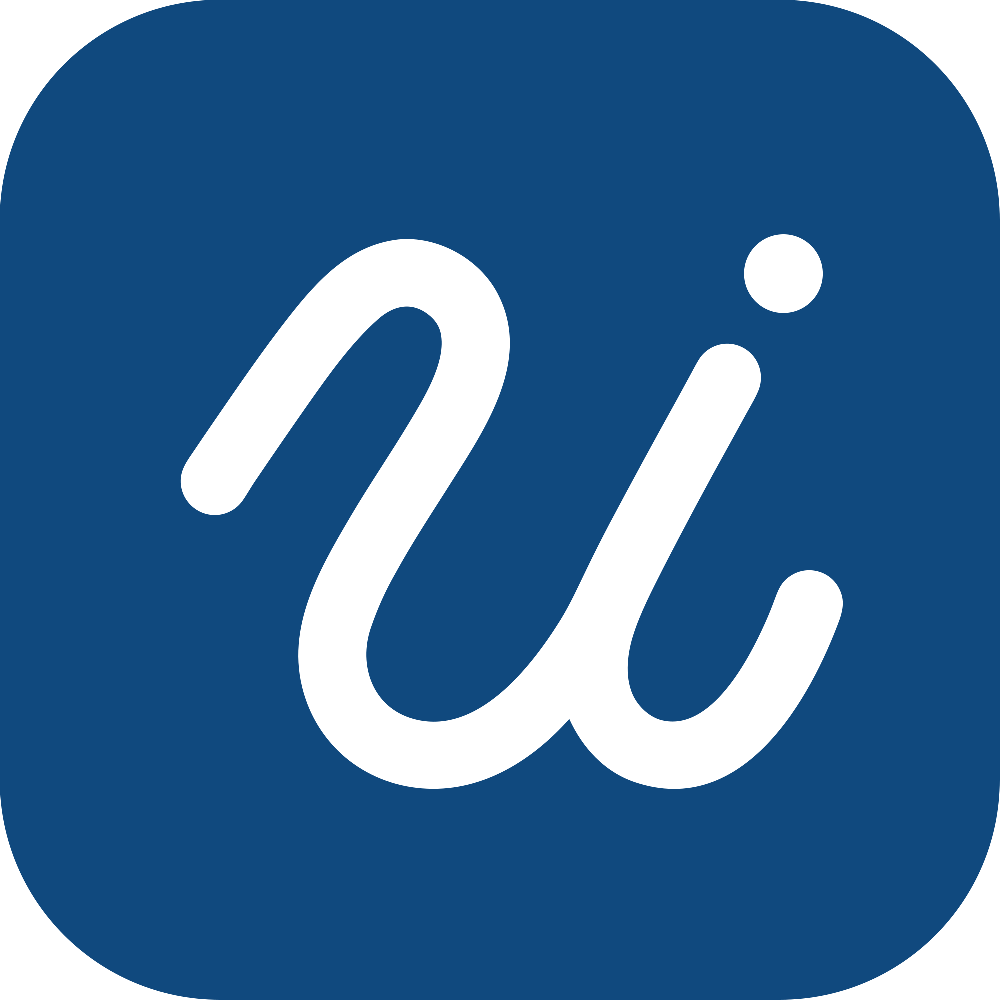

# uniMCP

I built uniMCP during my BSc. studies in
[Computational Engineering Science](https://www.ces.rwth-aachen.de/) at
[RWTH Aachen University](https://www.rwth-aachen.de/), to let an AI app help me
with my own courses, files, timetable and even the canteen menu.

It gives your AI app read-only access to your university and runs on your own
computer as an [MCP](https://modelcontextprotocol.io) server.

Unofficial, and not affiliated with any university.

## What it can do

| Tool                | What it reads                                      |
| ------------------- | -------------------------------------------------- |
| `list_courses`      | The courses you are enrolled in                    |
| `list_course_files` | Slides, exercise sheets and other course files     |
| `list_assignments`  | Assignments and their deadlines                    |
| `read_course_file`  | A course file, in the formats listed below         |
| `list_events`       | Your timetable: lectures, exercises, exam dates    |
| `list_canteen_menu` | What the canteens serve, with prices and allergens |
| `list_files`        | A folder in your cloud storage                     |
| `read_file`         | A file from your cloud storage, same formats       |
| `status`            | Which services are connected                       |

Files that can be read:

- **PDF**: as text, or page by page as pictures, so the AI also sees diagrams,
  formulas and scanned pages.
- **Word, PowerPoint, Excel** (`.docx`, `.pptx`, `.xlsx`): their text, slide
  by slide and sheet by sheet, and the pictures placed in Word and PowerPoint
  files.
- **Pictures** (PNG, JPEG, GIF, WebP): as pictures.
- **Zip archives**: a list of what is inside, and any of the files above out
  of them.
- **Plain text**, such as code, Markdown or CSV.

Not yet: password-protected PDFs, the old Office formats (`.doc`, `.ppt`,
`.xls`), vector drawings and charts inside Office files, and other archive
types.

## Prompts

Ready-made requests you pick from your AI app's menu, where the app supports
them:

| Prompt                | You fill in             | What it asks for                              |
| --------------------- | ----------------------- | --------------------------------------------- |
| My week               | nothing                 | This week's timetable and what is due in it   |
| Deadlines             | nothing                 | All open assignments, the soonest first       |
| Explain a lecture     | course, optional topic  | An explanation of the matching slides         |
| Help with an exercise | course, sheet           | Hints for an exercise sheet before a solution |
| Summarise a course    | course                  | An overview from all of the course's material |

## Safety

- **Read-only.** No tool can change, send, submit or delete anything.
- **Local.** Your data goes from the university straight to your computer.
- **No university password.** Moodle signs you in on the university's own page,
  cloud storage uses an app password, the calendar a link you publish yourself.
  The canteen menu is public and needs no login.
- **Logins live in your system keyring**, and never pass through the AI.

## Universities

| University             | Courses | Cloud storage | Timetable  | Canteens  |
| ---------------------- | ------- | ------------- | ---------- | --------- |
| RWTH Aachen University | Moodle  | Sciebo        | RWTHonline | OpenMensa |

A university is one file in [`profiles`](profiles). To add yours, see
[CONTRIBUTING.md](CONTRIBUTING.md).

## Getting started

Download `unimcp` for your system from the
[releases page](https://github.com/zahraabouzeid/uni-mcp/releases) and run it.

It opens the dashboard in your browser, where you connect your services, try
the tools, and get the line that adds it to your AI app.

Under **Settings** you can add custom instructions, such as what you study or
where you keep your examination regulations.

Browser sign-in for Moodle works on Windows only for now; elsewhere
`unimcp login moodle` asks you to paste a link.

### Building from source

You need [Rust](https://rustup.rs) and [Node.js](https://nodejs.org).

```sh
cd web && npm install && npm run build && cd ..
cargo build --release
./target/release/unimcp
```

## Contributing

Contributions are welcome, especially new universities. The rules and the
workflow are in [CONTRIBUTING.md](CONTRIBUTING.md).

## License

Copyright © 2026 Zahraa Bou Zeid. Licensed under the
[GNU Affero General Public License v3.0](LICENSE).
