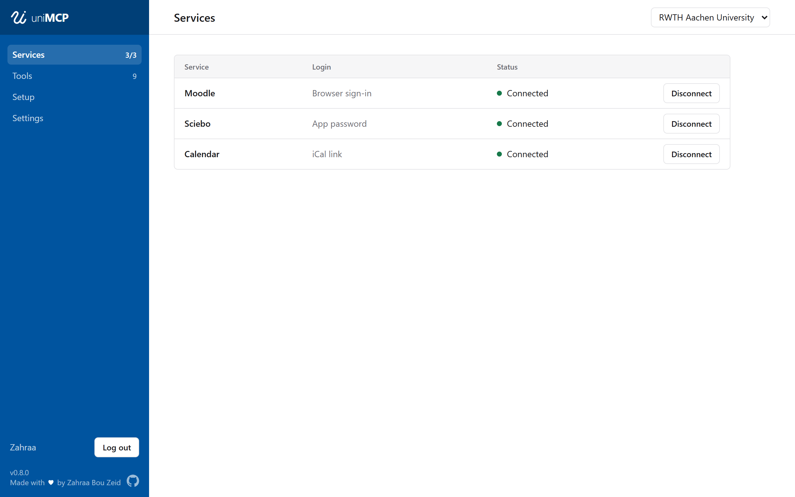
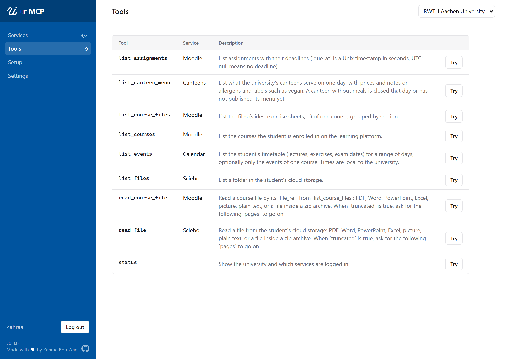
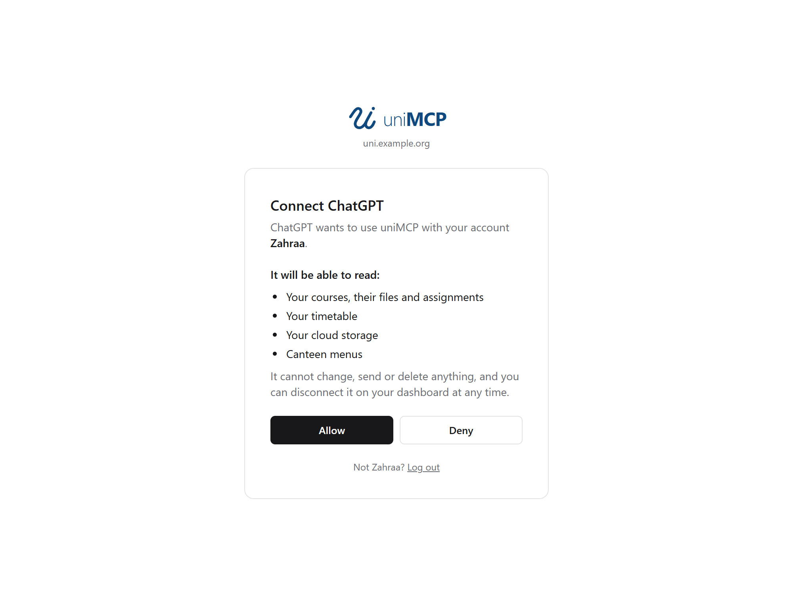

# uniMCP

I built uniMCP during my BSc. studies in
[Computational Engineering Science](https://www.ces.rwth-aachen.de/) at
[RWTH Aachen University](https://www.rwth-aachen.de/), so that an AI assistant
could help me with my own courses, files, timetable and even the canteen menu.

uniMCP is an [MCP](https://modelcontextprotocol.io) server that gives your AI
assistant read-only access to your university services. It runs locally on
your computer or on your own server, where several users can connect from any
device.

Unofficial, and not affiliated with any university.



## Tools



### Supported file formats

- **PDF**: extracted text, or individual pages rendered as images, which
  preserves diagrams, formulas and scanned pages.
- **Word, PowerPoint, Excel** (`.docx`, `.pptx`, `.xlsx`): text per slide and
  per sheet, plus the images embedded in Word and PowerPoint files.
- **Images** (PNG, JPEG, GIF, WebP): passed through unchanged.
- **Zip archives**: a listing of the contents, and any supported file inside.
- **Plain text**, such as source code, Markdown or CSV.

Not supported yet: password-protected PDFs, legacy Office formats (`.doc`,
`.ppt`, `.xls`), vector drawings and charts embedded in Office files, and
other archive formats.

## Prompts

Prompt templates, available in clients that support MCP prompts:

| Prompt                | Arguments                    | Description                                   |
| --------------------- | ---------------------------- | --------------------------------------------- |
| My week               | None                         | This week's timetable and the work due in it  |
| Deadlines             | None                         | All open assignments, soonest first           |
| Explain a lecture     | `course`, `topic` (optional) | An explanation of the matching lecture slides |
| Help with an exercise | `course`, `sheet`            | Hints for an exercise sheet before a solution |
| Summarise a course    | `course`                     | An overview based on all course material      |

## Security and privacy

- **Read-only.** No tool can modify, send, submit or delete anything.
- **Yours.** uniMCP runs on your computer or your own server and fetches your
  data directly from the university.
- **No university password.** Moodle uses the university's own sign-in page,
  cloud storage an app password, and the calendar a link you publish yourself.
  The canteen menu is public and requires no login.
- **Credentials stay in your system keyring**, or encrypted on your server,
  and are never exposed to the AI assistant.
- **AI assistants connect only with your permission.** On a server, an AI
  assistant gets access only after you log in and allow it, and only to your
  own account.

## Supported universities

| University             | Courses | Cloud storage | Timetable  | Canteens  |
| ---------------------- | ------- | ------------- | ---------- | --------- |
| RWTH Aachen University | Moodle  | Sciebo        | RWTHonline | OpenMensa |

Each university is defined by a single file in [`profiles`](profiles). To add
yours, see [CONTRIBUTING.md](CONTRIBUTING.md).

## Getting started

Download uniMCP from the
[releases page](https://github.com/zahraabouzeid/uni-mcp/releases):

- **Windows:** `unimcp-windows-x64.msi` installs uniMCP for your user account,
  adds a Start menu entry and makes the `unimcp` command available. No
  administrator rights are required.
- **Any platform:** the single `unimcp` file for your system runs without
  installation.

Then start uniMCP.

The dashboard opens in your browser. From there you can connect your services,
try out the tools, and add uniMCP to Claude Desktop, Claude Code, Codex or Gemini CLI
with one click. The configuration for any other AI assistant is there to copy.

Under **Settings** you can add custom instructions, for example your degree
programme or where you keep your examination regulations.

Browser sign-in for Moodle is currently available on Windows only. On other
platforms, run `unimcp login moodle` and paste the link when prompted.

### Running on a server

In server mode, one uniMCP serves several people, and each connects Claude,
ChatGPT and other AI assistants from any device. See
[deploy/README.md](deploy/README.md) for running it with Docker.



### Building from source

Requires [Rust](https://rustup.rs) and [Node.js](https://nodejs.org).

```sh
cd web && npm install && npm run build && cd ..
cargo build --release
./target/release/unimcp
```

## Contributing

Contributions are welcome, especially new universities. The rules and the
workflow are described in [CONTRIBUTING.md](CONTRIBUTING.md).

## License

Copyright © 2026 Zahraa Bou Zeid. Licensed under the
[GNU Affero General Public License v3.0](LICENSE).
