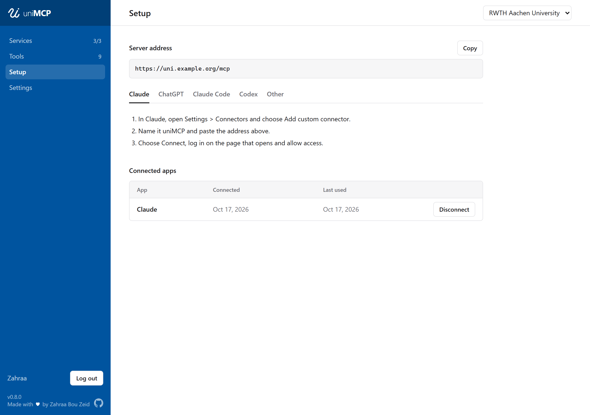
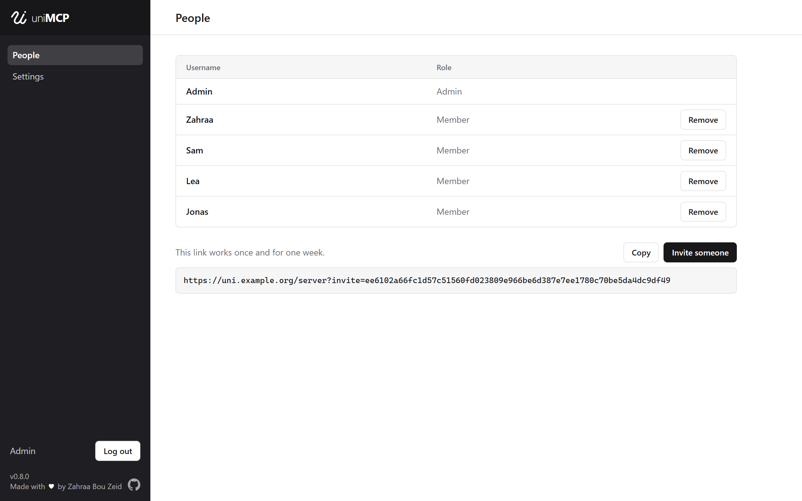

# Running uniMCP on a server

On a server, one uniMCP serves several people. Everyone gets their own account
and connects Claude, ChatGPT and other AI assistants to it from any device,
including their phone.



## Setup

You need a machine that is always on, such as a small cloud server, with
[Docker](https://docs.docker.com/engine/install/) installed.

1. Open ports 80 and 443 on the machine.
2. Get a domain for the machine's public IP address. A free one from
   [DuckDNS](https://www.duckdns.org) works, or use your own.
3. Download uniMCP:

   ```sh
   git clone https://github.com/zahraabouzeid/uni-mcp.git
   cd uni-mcp/deploy
   ```

4. Create the settings file and put your domain in it:

   ```sh
   cp .env.example .env
   nano .env
   ```

5. Start uniMCP:

   ```sh
   docker compose up -d
   ```

6. Show the link that creates your admin account and open it:

   ```sh
   docker compose logs app
   ```

7. Invite people under **People**. They open the invite, create their account
   and connect their AI assistants under **Setup**.

   

## Addresses

With the domain `unimcp.example.org`, the addresses are:

| Address                            | For                  |
| ---------------------------------- | -------------------- |
| `https://unimcp.example.org`       | Everyone's dashboard |
| `https://admin.unimcp.example.org` | The admin            |
| `https://unimcp.example.org/mcp`   | The MCP address      |

The HTTPS certificates are set up automatically.

## Behind your own proxy

If the server already runs a reverse proxy for other services, uniMCP can use it instead of
its own Caddy. Add this line to `.env`:

```sh
COMPOSE_FILE=compose.yaml:compose.shared-proxy.yaml
```

uniMCP then starts without Caddy and joins the Docker network `web` under the names
`unimcp` and `unimcp-dev`. Point your proxy at `unimcp:8787` for the dashboard and MCP
address, and at `unimcp:8788` for the admin. The deploy script creates the network if it
is missing.

## Updates

To update uniMCP, pull the latest version and run the deploy script:

```sh
git pull
./deploy.sh
```
